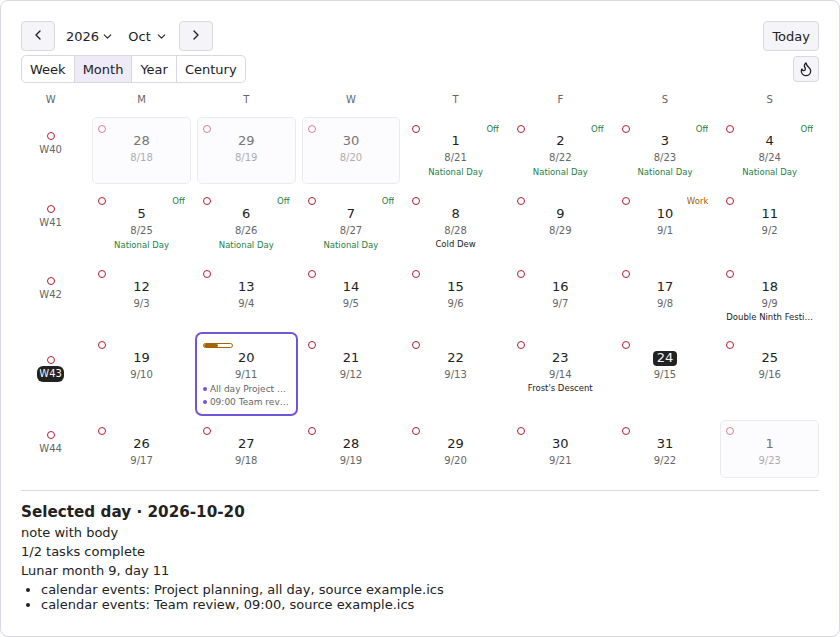
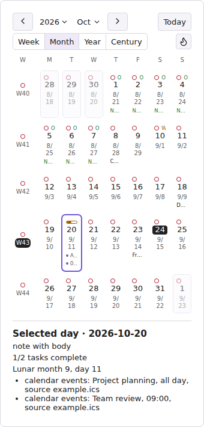

# Chrono Notes

[English](../../README.md) · [简体中文](README.zh-CN.md) · [繁體中文](README.zh-TW.md) · [日本語](README.ja-JP.md) · [한국어](README.ko-KR.md) · [Deutsch](README.de-DE.md) · [Français](README.fr-FR.md) · [Español](README.es-ES.md) · [Português (Brasil)](README.pt-BR.md) · [Русский](README.ru-RU.md) · [Tiếng Việt](README.vi-VN.md) · [العربية](README.ar.md) · [فارسی](README.fa.md) · [עברית](README.he.md) · [አማርኛ](README.am.md) · [हिन्दी](README.hi.md)

Chrono Notes מוסיף ל־Obsidian סביבת לוח שנה לניהול הערות תקופתיות, משימות, חגים, אירועים מקומיים והערות לטווח תאריכים.

זהו **מדריך מקוצר** למשימות נפוצות. הסברים מלאים על הגדרות ומגבלות נמצאים במדריך [באנגלית](../../README.md) או [בסינית פשוטה](README.zh-CN.md).

## יכולות

פריסות רחבה וצרה עדכניות, שהופקו מממשק התוסף בסביבת בדיקה בדפדפן. אלה דוגמאות לפריסה, ולא צילומי מסך מתוך Obsidian או Android.






- תצוגות שבוע, חודש, שנה ומאה עם מצב הערות, משימות, נתונים סטטיסטיים ותצוגה מקדימה.
- הערות יומיות, שבועיות, חודשיות, רבעוניות, שנתיות, עשוריות ומאה־שנתיות בעזרת תבניות מובנות או Templater.
- ניווט בין הערות, מעקב אחר השלמת משימות, מפות חום והערות לטווח תאריכים.
- לוחות שנה סיני ירחי, פרסי, אתיופי, עברי, הודי ואסלאמי, וחגים בסין ובסינגפור.
- קריאת קובצי ICS מקומיים בלבד והתאמה של הצגת תאריך ושעה בלי לשנות ערכי YAML.

## דרישות ותאימות

נדרשת גרסת Obsidian 1.12.7 ומעלה במחשב או בטלפון. קובצי ICS בתוך ה־Vault פועלים בפלטפורמות הנתמכות; נתיבים מחוץ ל־Vault נתמכים במחשב בלבד. לוחות שנה נוספים תלויים בנתונים שזמינים בסביבת ההרצה.

## התקנה

### תוספים קהילתיים

 ב־Obsidian פתחו **הגדרות ← תוספים קהילתיים ← עיון**, חפשו **Chrono Notes**, בחרו **התקנה** ואז **הפעלה**.

### התקנה ידנית

 הורידו `chrono-notes-<version>.zip` מ[הגרסה העדכנית](https://github.com/ZHYX91/obsidian-chrono-notes/releases/latest), וחלצו ל־`Vault/.obsidian/plugins/`. התיקייה `chrono-notes/` מכילה את `main.js`, `manifest.json` ו־`styles.css`. טענו מחדש את Obsidian והפעילו את התוסף.

### עדכון

 גבו ושמרו את `data.json`. החליפו רק את קובצי התוסף; מחקו `data.json` רק אם ברצונכם לאפס את ההעדפות.

## אופן השימוש

הלוח הראשי, בוחרי החודשים וחלונות התאריך משתמשים תמיד בלוח הגרגוריאני. שינוי שפת הממשק משנה את שמות החודשים והספרות, אך לא את סוג הלוח. אפשר לבחור הרחבות לוח בנפרד כדי להציג מידע נוסף.

**לפני הוספת ICS:** ‏Chrono Notes קורא קבצים מקומיים בלבד ואינו מוריד מינויים מרוחקים או מרחיב אירועים חוזרים עם `RRULE` או `RDATE`. מספר האירועים שדולגו מדווח, ולכן לוח שנה המתבסס על חזרות עלול להיראות חלקי. נתיבים מחוץ ל־Vault נתמכים במחשב שולחני בלבד.

בהגדרות בחרו את סוגי ההערות התקופתיות, הנתיבים והתבניות, ואז פתחו את לוח השנה דרך הסרגל או לוח הפקודות. **לחיצה אחת בוחרת תאריך בלבד ואינה יוצרת הערה.** לחיצה כפולה או Enter פותחות או יוצרות הערה. לחיצה ימנית פותחת את פעולות התאריך; אם יש באותו יום אירועי ICS, האפשרות „הצגת אירועי לוח שנה” פותחת את הרשימה המלאה שלהם. Ctrl/Cmd עם לחיצה, או הכפתור האמצעי, פותחים בלשונית חדשה. אפשר להפעיל לוחות שנה נוספים, חגים ומקורות ICS מקומיים לפי הצורך.

במסך מגע, לחצו ממושכות על תאריך כדי לפתוח את התפריט שלו ובחרו באפשרות לפתיחה או ליצירה של הערה יומית. אם לא מופיע תפריט, ההערה היומית נפתחת או נוצרת כשמרימים את האצבע. לחיצה ממושכת על תא של שבוע, חודש או תקופה אחרת פותחת ישירות את ההערה המתאימה.

בחרו תאריך בתצוגת החודש כדי לקרוא מתחת לרשת את מצב ההערה, פרטי הלוח, החגים וכל אירועי ICS עם המקורות. כאשר אישור יצירה פעיל, החלון מציג את נתיב היעד ואת ההערות לתקופות גדולות יותר שייווצרו או יישמרו.

### הצגת משימות בלוח השנה

הוסיפו להערה משימה עם תיבת סימון וסמן תאריך:

```markdown
- [ ] הגשת הדוח השבועי 📅 2026-10-20
- [ ] הכנת החומרים 🛫 2026-10-18 ⏳ 2026-10-19 📅 2026-10-20
```

`🛫` מציין תאריך התחלה, `⏳` תאריך מתוכנן ו־`📅` מועד אחרון. כתבו תאריכים בפורמט `YYYY-MM-DD`. תצוגת השבוע מציגה משימות שאחד מהתאריכים האלה שלהן חל בשבוע המוצג. משימה מופיעה בכל תאריך נפרד; כמה סמנים לאותו יום יוצרים רשומה אחת בלבד באותו יום. גם משימות ללא תאריך נספרות בהתקדמות המשימות של ההערה.

בתצוגת השבוע אפשר להעביר את המועד האחרון ליום אחר בשבוע המוצג באמצעות הרשימה הנפתחת של התאריך. במחשב אפשר גם לגרור משימה בעלת מועד אחרון אל היום הרצוי. פעולות אלה משנות את המועד האחרון שכבר מופיע בהערה המקורית.

תיבת הסימון של משימה בתצוגת השבוע משנה את מצבה בהערת המקור. בזמן עדכון, התיבה, בחירת המועד והגרירה של אותה משימה מושבתות; שגיאות או אזהרות שמירה מופיעות לצדה. אם התוצאה אינה ודאית, בדקו את הערת המקור לפני ניסיון נוסף. רשימות של יותר מ־100 רשומות מחולקות לעמודים באמצעות „המשימות הקודמות” ו„המשימות הבאות”, והספירה הכוללת נשמרת.

### הערות לעשור ולמאה

בתצוגת המאה כל עשור מוצג ליד שתי שורות של חמש שנים. בחלון צר תא העשור עובר מעל השנים; כשסרגל הצד צר מאוד או גודל הטקסט גדול, השנים מוצגות בשתי עמודות. מקומות של שנים מחוץ למאה נשארים ריקים. עם הכניסה מוצג העשור שאליו שייכת השנה שנבחרה. „המאה הנוכחית” מחזירה לעשור הנוכחי, ופס הניווט נשאר גלוי בזמן גלילה.

הפעילו בהגדרות הערות לעשור ולמאה, ואז עברו לתצוגת „מאה” בסרגל הצד. לעשור ולמאה יש תאים נפרדים. לחיצה אחת רק בוחרת; לחיצה כפולה או Enter פותחות או יוצרות הערה. Ctrl/Cmd עם לחיצה או לחצן עכבר אמצעי פותחים לשונית חדשה, ובמסך מגע אפשר ללחוץ ממושכות. סימוני מצב, התקדמות המשימות והתצוגה המקדימה זהים לאלה שבתצוגת השנה. נתיבי ברירת המחדל הם `[diary]/DEC[s]` (למשל 2020s) לעשור ו־`[diary]/[C]CEN` (למשל C21) למאה.

עשור משתרע למשל על 2020–2029, והמאה ה־21 על 2001–2100. `DEC` ו־`CEN` מפיקים ספרות קבועות ללא תלות בשפת הממשק. עדיף לארגן תיקיות לפי מאה או לפי עשור, ולא לשלב את שתיהן זו בתוך זו: שנות ה־2000 חוצות את C20/C21, אך הערת העשור משויכת ל־C20 לפי שנת ההתחלה 2000. הערות קיימות אינן מועברות אוטומטית.

בתבניות אפשר להשתמש ב־`{{date:DEC[s]}}`, ב־`{{date:[C]CEN}}` וב־`{{start:YYYY}}–{{end:YYYY}}`. כל התבניות התקופתיות תומכות בתאריכי התחלה וסיום ובמספר הימים `{{days}}` שכולל את שני הקצוות. דפי ההגדרות מפרטים משתנים ודוגמאות וגם ביטויים מקבילים ב־Templater; כללי העיצוב המשותפים נמצאים ב־„כללי ← הגדרות תבניות”.

### הערות לטווח תאריכים

בחרו תחילה תיקייה לשמירה דרך **הגדרות ← Chrono Notes ← הערות טווח**. במחשב, גררו מתאריך התחלה לתאריך סיום אחר בלוח החודשי כדי ליצור הערה לטווח תאריכים. אפשר גם לבחור „צור הערת טווח” מתפריט התאריך או מלוח הפקודות ולהזין את התאריכים. טווח חדש חייב לכלול לפחות שני ימים בלוח השנה; אם התאריכים הוזנו בסדר הפוך, הם מסודרים אוטומטית מהקודם למאוחר.

כדי להציג הערה קיימת כטווח, הוסיפו את המאפיינים הבאים בתחילת קובץ ה־Markdown שלה:

```yaml
---
chrono-notes: interval
start: 2026-10-18
end: 2026-10-20
---
```

השתמשו בתאריכים מלאים בפורמט `YYYY-MM-DD`, כאשר ההתחלה אינה מאוחרת מהסיום. הטווח המוצג כולל את שני התאריכים. בהערות קיימות אפשר גם להשתמש בתאריך ושעה מלאים בפורמט ISO, הכוללים לפחות שעות ודקות, או בטווח בתוך יום אחד.

הערה לטווח תאריכים חייבת להכיל מאפיינים תקינים `start` ו־`end`. Chrono Notes כותב בהערות חדשות גם `chrono-notes: interval`, ולכן הן מזוהות בכל מקום בתוך ה־Vault.

אם המאפיין `chrono-notes` חסר, ההערה מזוהה רק בתחום החיפוש שהוגדר עבור הערות לא מסומנות. אם המאפיין מכיל ערך שאינו `interval`, ההערה לא תזוהה. הערות קיימות אינן משתנות אוטומטית.

## הגדרות

בהגדרות הכלליות נמצאים המדריך למשתמש ודיווח על בעיה. לאחר שינוי הרחבת לוח או חגים, לשונית ההגדרות הפעילה נשארת גלויה והמיקוד נשאר בפקד שבו השתמשתם.

אפשר להגדיר את שפת הממשק, היום הראשון בשבוע, הצגת התאריך, נתיבי ההערות והתבניות. שינוי השפה שמשמשת לשמות קבצים אינו משנה שמות קיימים; בדקו קודם את תצוגת הנתיב. יש הגדרות נפרדות לתצוגות, למשימות, לסטטיסטיקה ולהרחבות.

## מגבלות

- מקורות ICS הם קבצים מקומיים לקריאה בלבד; מנויים ללוחות שנה מרוחקים אינם נטענים ישירות. כברירת מחדל נקראים לכל היותר 32 מקורות בכל רענון, ומקורות נוספים מדווחים כמושמטים. אירועים חוזרים עם `RRULE` או `RDATE` מושמטים ונספרים, בלי להציג את כל המופעים שלהם.
- הגדרות אזורי זמן בתוך קובצי ICS תומכות בכללי שעון קיץ שנתיים נפוצים ובתאריכי מעבר שעון שצוינו במפורש. אם ההגדרה אינה תקינה, אינה נתמכת או כוללת מעברים רבים מדי, האירועים התלויים בה מושמטים ומוצג דיווח על כך.
- חגים שטרם פורסמו רשמית אינם מחושבים על סמך תחזית. החלפת לוח השנה משנה את התצוגה בלבד; שמות ההערות, ניווט בין תאריכים ותאריכי המשימות נשארים לפי הלוח הגרגוריאני. לוחות שנה שסביבת ההרצה אינה תומכת בהם מוסתרים.
- אופן השימוש והפריסה במכשירים ניידים עשויים להשתנות לפי גרסת Obsidian, המכשיר ואמצעי הקלט.

## פרטיות ואבטחה

התוסף קורא הערות Markdown רלוונטיות וקובצי ICS מקומיים שנבחרו כדי לבנות אינדקס ולהציג את לוח השנה. המידע אינו מועלה לרשת ולא נדרש חשבון. האינדקס הנגזר נשמר ב־IndexedDB המקומי וניתן לבנות אותו מחדש. התוסף אינו קורא את הלוח; הוא כותב אליו תאריך רק בעקבות בחירה ב״העתקת תאריך״.

## פיתוח

לפיתוח נדרשים Node.js 24.19.0 ו־npm 11.17.0. הריצו `npm ci` ולאחר מכן `npm run check`. ראו [ארכיטקטורה](../architecture.en.md) ו[אסטרטגיית בדיקות](../testing-strategy.en.md).

## תמיכה

לשאלות ורעיונות היכנסו ל[דיונים](https://github.com/ZHYX91/obsidian-chrono-notes/discussions). דווחו על תקלות שניתן לשחזר ב־[Issues](https://github.com/ZHYX91/obsidian-chrono-notes/issues/new/choose) ועל חולשות אבטחה [באופן פרטי](https://github.com/ZHYX91/obsidian-chrono-notes/security/advisories/new). אל תפרסמו תוכן אישי מה־Vault.

## רישיון

[MIT](../../LICENSE) © ZhengYX

## תודות

בהשראת [Calendar](https://github.com/liamcain/obsidian-calendar-plugin) ו־[Dust Calendar](https://github.com/a-nano-dust/dust-obsidian-calendar).
