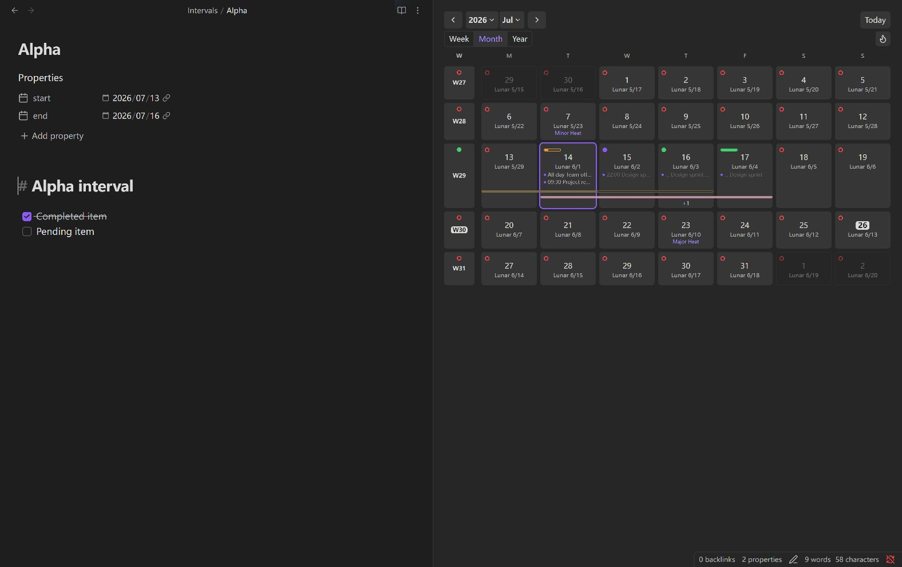
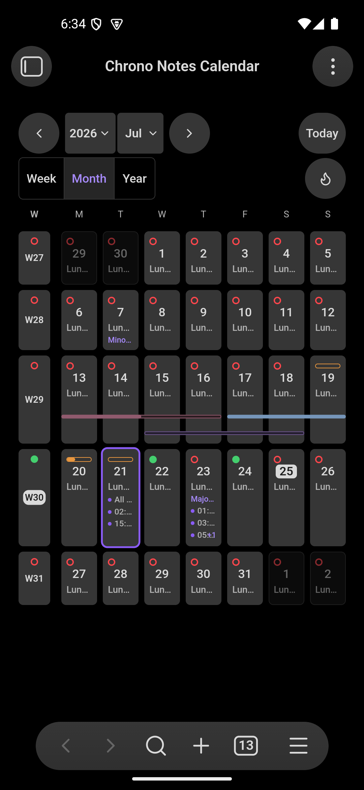

# Chrono Notes

[English](../../README.md) · [简体中文](README.zh-CN.md) · [繁體中文](README.zh-TW.md) · [Deutsch](README.de-DE.md) · [Français](README.fr-FR.md) · [Español](README.es-ES.md) · [Português](README.pt-BR.md) · [Русский](README.ru-RU.md) · [日本語](README.ja-JP.md) · [한국어](README.ko-KR.md) · [Tiếng Việt](README.vi-VN.md) · [العربية](README.ar.md) · [فارسی](README.fa.md) · [עברית](README.he.md) · [አማርኛ](README.am.md) · [हिन्दी](README.hi.md)

Chrono Notes מוסיף ל־Obsidian סביבת לוח שנה לניהול הערות תקופתיות, משימות, חגים, אירועים מקומיים והערות לטווח תאריכים.

## יכולות

כך נראה לוח השנה במחשב וב־Android:

- תצוגות שבוע, חודש, שנה ומאה עם מצב הערות, משימות, נתונים סטטיסטיים ותצוגה מקדימה.
- הערות יומיות, שבועיות, חודשיות, רבעוניות, שנתיות, עשוריות ומאה־שנתיות בעזרת תבניות מובנות או Templater.
- ניווט בין הערות, מעקב אחר השלמת משימות, מפות חום והערות לטווח תאריכים.
- לוחות שנה סיני ירחי, פרסי, אתיופי, עברי, הודי ואסלאמי, וחגים בסין ובסינגפור.
- קריאת קובצי ICS מקומיים בלבד והתאמה של הצגת תאריך ושעה בלי לשנות ערכי YAML.

## דרישות ותאימות

נדרשת גרסת Obsidian 1.12.7 ומעלה במחשב או בטלפון. קובצי ICS בתוך ה־Vault פועלים בפלטפורמות הנתמכות; נתיבים מחוץ ל־Vault נתמכים במחשב בלבד. לוחות שנה נוספים תלויים בנתונים שזמינים בסביבת ההרצה.

## התקנה

### תוספים קהילתיים

 ב־Obsidian פתחו **הגדרות ← תוספים קהילתיים ← עיון**, חפשו **Chrono Notes**, בחרו **התקנה** ואז **הפעלה**.

### התקנה ידנית

 הורידו `chrono-notes-<version>.zip` מ[הגרסה העדכנית](https://github.com/ZHYX91/obsidian-chrono-notes/releases/latest), וחלצו ל־`Vault/.obsidian/plugins/`. התיקייה `chrono-notes/` מכילה את `main.js`, `manifest.json` ו־`styles.css`. טענו מחדש את Obsidian והפעילו את התוסף.

### עדכון

 גבו ושמרו את `data.json`. החליפו רק את קובצי התוסף; מחקו `data.json` רק אם ברצונכם לאפס את ההעדפות.

## אופן השימוש

בהגדרות בחרו את סוגי ההערות התקופתיות, הנתיבים והתבניות, ואז פתחו את לוח השנה דרך הסרגל או לוח הפקודות. **לחיצה אחת בוחרת תאריך בלבד ואינה יוצרת הערה.** לחיצה כפולה או Enter פותחות או יוצרות הערה; במסך מגע משתמשים בלחיצה ממושכת. לחיצה ימנית פותחת את פעולות התאריך. Ctrl/Cmd עם לחיצה, או הכפתור האמצעי, פותחים בלשונית חדשה.

### הערות לעשור ולמאה

בתצוגת המאה כל עשור מוצג ליד שתי שורות של חמש שנים. בחלון צר תא העשור עובר מעל השנים, ומקומות של שנים מחוץ למאה נשארים ריקים. עם הכניסה מוצג העשור שאליו שייכת השנה שנבחרה. „המאה הנוכחית” מחזירה לעשור הנוכחי, ופס הניווט נשאר גלוי בזמן גלילה.

הפעילו בהגדרות הערות לעשור ולמאה, ואז עברו לתצוגת „מאה” בסרגל הצד. לעשור ולמאה יש תאים נפרדים. לחיצה אחת רק בוחרת; לחיצה כפולה או Enter פותחות או יוצרות הערה. Ctrl/Cmd עם לחיצה או לחצן עכבר אמצעי פותחים לשונית חדשה, ובמסך מגע אפשר ללחוץ ממושכות. סימוני מצב, התקדמות המשימות והתצוגה המקדימה זהים לאלה שבתצוגת השנה. נתיבי ברירת המחדל הם `[diary]/DEC[s]` (למשל 2020s) לעשור ו־`[diary]/[C]CEN` (למשל C21) למאה.

עשור משתרע למשל על 2020–2029, והמאה ה־21 על 2001–2100. `DEC` ו־`CEN` מפיקים ספרות קבועות ללא תלות בשפת הממשק. עדיף לארגן תיקיות לפי מאה או לפי עשור, ולא לשלב את שתיהן זו בתוך זו: שנות ה־2000 חוצות את C20/C21, אך הערת העשור משויכת ל־C20 לפי שנת ההתחלה 2000. הערות קיימות אינן מועברות אוטומטית.

בתבניות אפשר להשתמש ב־`{{date:DEC[s]}}`, ב־`{{date:[C]CEN}}` וב־`{{start:YYYY}}–{{end:YYYY}}`. כל התבניות התקופתיות תומכות בתאריכי התחלה וסיום ובמספר הימים `{{days}}` שכולל את שני הקצוות. דפי ההגדרות מפרטים משתנים ודוגמאות וגם ביטויים מקבילים ב־Templater; כללי העיצוב המשותפים נמצאים ב־„כללי ← הגדרות תבניות”.

### זיהוי הערות לטווח תאריכים

הערה לטווח תאריכים חייבת להכיל מאפיינים תקינים `start` ו־`end`. Chrono Notes כותב בהערות חדשות גם `chrono-notes: interval`, ולכן הן מזוהות בכל מקום בתוך ה־Vault.

אם המאפיין `chrono-notes` חסר, ההערה מזוהה רק בתחום החיפוש שהוגדר עבור הערות לא מסומנות. אם המאפיין מכיל ערך שאינו `interval`, ההערה לא תזוהה. הערות קיימות אינן משתנות אוטומטית.

## הגדרות

אפשר להגדיר את שפת הממשק, היום הראשון בשבוע, הצגת התאריך, נתיבי ההערות והתבניות. שינוי השפה שמשמשת לשמות קבצים אינו משנה שמות קיימים; בדקו קודם את תצוגת הנתיב. יש הגדרות נפרדות לתצוגות, למשימות, לסטטיסטיקה ולהרחבות.

## מגבלות

קובצי ICS מקומיים הם לקריאה בלבד; מנויים מרוחקים אינם נשלפים ישירות. כברירת מחדל נקראים לכל היותר 32 מקורות בכל רענון. אירועים חוזרים עם `RRULE` או `RDATE` נספרים אך אינם נפרסים. לא מנחשים חגים שטרם פורסמו. חלק מלוחות השנה תלויים בסביבת ההרצה.

## פרטיות ואבטחה

התוסף קורא הערות Markdown רלוונטיות וקובצי ICS מקומיים שנבחרו כדי לבנות אינדקס ולהציג את לוח השנה. המידע אינו מועלה לרשת ולא נדרש חשבון. האינדקס הנגזר נשמר ב־IndexedDB המקומי וניתן לבנות אותו מחדש. התוסף אינו קורא את הלוח; הוא כותב אליו תאריך רק בעקבות בחירה ב״העתקת תאריך״.

## פיתוח

לפיתוח נדרשים Node.js 24.19.0 ו־npm 11.17.0. הריצו `npm ci` ולאחר מכן `npm run check`. ראו [ארכיטקטורה](../architecture.en.md) ו[אסטרטגיית בדיקות](../testing-strategy.en.md).

## תמיכה

לשאלות ורעיונות היכנסו ל[דיונים](https://github.com/ZHYX91/obsidian-chrono-notes/discussions). דווחו על תקלות שניתן לשחזר ב־[Issues](https://github.com/ZHYX91/obsidian-chrono-notes/issues/new/choose) ועל חולשות אבטחה [באופן פרטי](https://github.com/ZHYX91/obsidian-chrono-notes/security/advisories/new). אל תפרסמו תוכן אישי מה־Vault.

## רישיון

[MIT](../../LICENSE) © ZhengYX

## תודות

בהשראת [Calendar](https://github.com/liamcain/obsidian-calendar-plugin) ו־[Dust Calendar](https://github.com/a-nano-dust/dust-obsidian-calendar).
